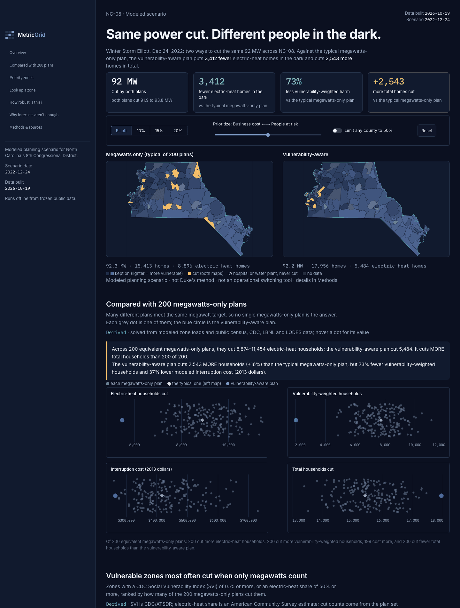
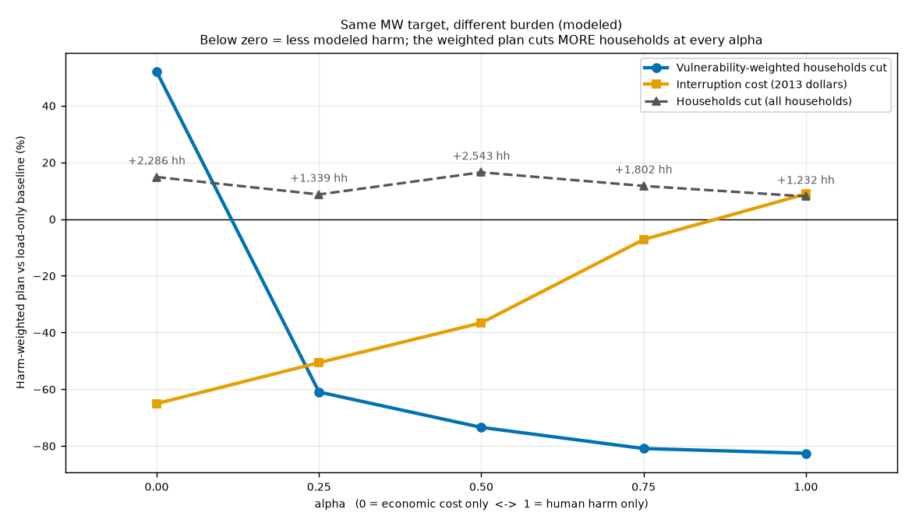

# METRIC-Grid

METRIC-Grid helps emergency planners and community stakeholders compare how load-only and vulnerability-aware outage scenarios could distribute risk across North Carolina's 8th Congressional District (NC-08).

A Congressional App Challenge entry. It is a **public-data planning simulator**: not Duke's method, not an operational switching tool, and not a prediction of what any utility did or will do.

The primary interface is now a **React + Vite web app for Vercel**. It runs the existing precomputed scenarios in the browser without Streamlit, Python functions, API keys, or a database at runtime. The original Python model, data pipeline, and legacy Streamlit interface are retained for reproducibility.

## Map-first planning workspace

Explore the district with local search, map layers, county filtering and zone details. Compare precomputed scenarios with synchronized maps. Prepare a manually selected shortlist with browser-local notes, CSV export and a printable evidence summary. This is a planning aid for investigation, not a validated siting tool.

Optional testimonials are read from `docs/quotes.yaml` at build time; only entries with `permission: true` and nonempty `name`, `role`, and `quote` are included. The optional `docs/author_story.md` is rendered as plain text. Both files ship empty, and no empty sections are displayed. Owners must supply and review this content.

## Run the web app

Requires Node.js 22.12+ (Node 24 also works).

```bash
npm ci
npm run dev       # http://127.0.0.1:5173
npm test          # parity checks against every original precomputed scenario
npm run build    # production output in dist/
npm run preview  # serve the production build locally
```

The build exports `data/frozen/` and relevant `config.yaml` settings to browser-safe JSON, converts non-finite Python JSON values to `null`, and bundles the existing fonts locally. Maps use tract geometry and SVG; charts and scenario calculations run locally. Data and model changes still happen in the Python pipeline, followed by a new web build. Every supported control setting uses the original precomputed results; there is no live optimizer.

The web interface includes the paired maps, reduction and alpha controls, county cap, all 200-plan comparisons, current-scenario priority zones, zone and example-building lookup, sensitivity results, the optional demand panel, methods and sources, and JSON scenario export. Missing or infeasible settings disclose the nearest available result. Deep links retain the original format: `?alpha=1&pct=10&cap=1&zone=23`.

## Deploy to Vercel

Import this repository into Vercel with the repository root as the Root Directory. `vercel.json` sets the framework to **Vite**, install command to `npm ci`, build command to `npm run build`, and output directory to **dist**. No environment variables or Python install are required.

Or deploy from the repository root with the Vercel CLI:

```bash
npx vercel          # preview deployment; authenticate when prompted
npx vercel --prod   # production deployment
```

`npm test` checks all 40 precomputed scenarios, comparison distributions, target bands, county caps, protected zones, example buildings, and deep links. For browser acceptance checks, install Playwright in your development environment and run `node scripts/workspace-smoke.cjs`. `PLAYWRIGHT_MODULE` can select a bundled Playwright module; `BROWSER_EXECUTABLE` can select another Chromium executable (default: Chrome). `SMOKE_URL` selects a deployed or production-preview URL. Screenshots and downloads are saved to ignored `artifacts/`.



## What it does

When a utility cannot meet demand it sheds load by opening breakers at substations. On December 24, 2022 (Winter Storm Elliott), Duke Energy Carolinas began shedding at 6:14 a.m. and shed up to 1,000 MW, and Duke Energy Progress shed up to 961 MW. Publicly described procedures protect critical facilities but publish no community-vulnerability layer.

METRIC-Grid takes the observed regional demand curves from that morning (EIA-930), public census vulnerability data, and published interruption-cost figures, scales the regional event down to the district, and solves two plans held to the same MW band:

- **load-only plans**: any way of cutting the required MW with little overshoot, ignoring who lives there (there are very many; the app generates a fixed, reproducible set of 200 and shows the typical one);
- a **vulnerability-aware plan**: cut the same MW band at the lowest modeled harm.

It shows the vulnerability-aware plan next to a typical load-only plan on a map of 183 census tract zones, and against the whole set of load-only plans in a strip chart,, with every assumption exposed in the page and in `docs/ASSUMPTIONS.md`.

**Primary user:** a county emergency planner who wants to know whether two technically equal scenarios could impose very different consequences on vulnerable communities, and who leaves with a short list of zones to prioritize for outreach, warming centers and backup power. **Not for:** utility operators (they would need private network data) or residents (no household prediction).

## The default scenario (modeled)

Required reduction 91.9 MW (modeled district estimate, scaled to the hour ending 07:00 on Dec 24, 2022), alpha 0.5, both plans cut between 91.9 and 93.8 MW. Many different plans meet the same MW target equally well, so the app compares the vulnerability-aware plan with **200 equivalent load-only plans** (the left map shows the typical one, the median of the set):

| | Typical load-only plan | Range over 200 load-only plans | Vulnerability-aware plan |
|---|---|---|---|
| MW cut | 92.3 | 91.9 to 92.8 | 92.2 |
| Zones cut | 11 | | 10 |
| Households cut | 15,413 | 13,387 to 17,458 | 17,956 |
| Electric-heat households cut | 8,896 | 6,874 to 11,454 | 5,484 |
| Vulnerability-weighted households | 7,741 | 4,784 to 11,116 | 2,053 |
| Interruption cost (2013 dollars, 1 hour) | $417,615 | $260,199 to $731,161 | $264,733 |

**The vulnerability-aware plan cuts 3,412 fewer electric-heat households than the typical load-only plan, and fewer than all 200 plans; but it cuts MORE total households (+2,543 vs the typical plan, and more than 200 of 200 plans).** It also concentrates 88% of its cut in one low-vulnerability county (Union). At alpha 0 (cost only) it does worse than the typical plan on human harm. The page says all of this in plain words next to the numbers, and shows where the vulnerability-aware plan falls among all 200 load-only plans for each measure. Because one "load-only baseline" would be arbitrary (a 0.02% change in the inputs flipped half of its zones), no single baseline is used as the headline reference; see `docs/ASSUMPTIONS.md`, "Baseline plan instability and the load-only plan set".



## Why forecasts aren't enough (winter demand model)

A small model of winter hourly demand for the two Duke balancing authorities from temperature and calendar (EIA-930 and airport temperatures, eight winters), validated with leave-one-winter-out cross-validation and a held-out December 2022. **Modeled demand estimate; not a utility forecast; it does not predict outages or available supply.** The app panel shows the honest result: cross-validated error about 3.7% (DUK+CPLE), but at the hour ending 07:00 (06:00-07:00) on Dec 24, 2022 it **under-predicted by 12.6%** (29,369 MW predicted vs 33,590 MW actual), because extreme cold is rare in the training data, and observed demand already excluded shed load. Only a precomputed curve ships (no scikit-learn at runtime; the panel hides itself if its file is missing). The full protocol and every number are in `docs/ASSUMPTIONS.md` (section "Winter demand model"); `make demand-train` re-runs it offline.

## Honest limits

- **Everything at district scale is modeled, not observed.** District load and the required reduction are scaled from two balancing-authority demand series with a weight built from housing units and jobs. The Elliott regional event anchors the scenario; NC-08 load and required reduction are modeled district-scale estimates, not observed utility values.
- **Zones are census tracts, not utility boundaries.** The public substation layer was not reachable, so there are no substation zones. Tracts are used whole, including parts outside the district, so district totals include some people just outside the boundary.
- **Residential load per unit is statewide.** NREL ResStock has no county aggregates, so every home gets the same per-unit load; residential weights are effectively housing units. ResStock mostly sets the ratio of home to commercial load. Electric heat is not in the load weight (version 2.0).
- **Critical-facility exclusions are conservative and incomplete.** Zones with a hospital, nursing home or water treatment plant are never cut (26 zones, 16.5% of modeled load). The facility points come from OpenStreetMap, which is incomplete. Fire and police stations are display-only.
- **Costs are 2013 dollars and one commercial rate.** The LBNL report gives costs by customer size, not by sector, and per average kW, which likely overstates a cold-morning job. The Small C&I rate is a sensitivity row.
- **Judgment calls:** harm weights (0.7 SVI, 0.3 electric heat), a 1-hour outage, a 2% band, a 10 kW baseline tolerance, splitting counties served by both utilities by estimated customers, and using each utility's maximum shed. All are in `config.yaml` and varied in the sensitivity table.
- **No validation against actual outage records.** Nothing here says where Duke did or would cut. The priority list (high-vulnerability zones that the most load-only plans cut) comes from a plan set that is not a uniform sample, so its frequencies are indicative, not a finding about specific neighborhoods.

## Original Python pipeline and legacy Streamlit demo

```bash
python3.11 -m venv .venv && .venv/bin/pip install -r requirements-dev.txt   # needs network once, to install packages
make test        # runs the tests; no network, no API keys
make demo        # opens the app on the frozen scenario (http://localhost:8765)
```

`requirements.txt` contains the legacy Python interface dependencies (pinned); `requirements-dev.txt` adds the test, figure and data-refresh tools. **In a clean clone `make test` skips 7 tests and passes the rest:** the seven data-pull checks (tract count, GEOID cleanliness, no silent NaN fills, facility types, the area-join identity check, the saved EIA series, the county table) need the raw downloads in `data/raw/`, which are gitignored; they run after `make data`. The skips say "run `make data` first".

The app reads only `data/frozen/` (committed, about 1 MB). There are no live API calls at runtime and it renders with every network call blocked (a test does exactly that). `make data` (needs `EIA_API_KEY` and `CENSUS_API_KEY` in `.env`) and `make freeze` rebuild the frozen inputs from the public sources (`make freeze` takes about 6 minutes because it generates the load-only plan sets); they are only needed to refresh data. Deep links for the controls: `?alpha=1&pct=10&cap=1&zone=23`.

## Data sources and dates

| Source | Vintage | Used for |
|---|---|---|
| Census TIGER/Line 2024 (district, tracts) | 2024 | NC-08 boundary and tracts |
| Census ACS 5-year | 2020-2024 | households, heating fuel, housing units |
| CDC/ATSDR Social Vulnerability Index | 2022 | vulnerability (RPL_THEMES) |
| LEHD LODES8 WAC | 2023 | jobs by sector |
| OpenStreetMap via Overpass | pulled 2026-10-18 | hospitals, nursing homes, water treatment (and display-only types) |
| EIA-930 hourly demand (DUK, CPLE, CPLW) | 2022-12-22 to 26 | regional demand |
| EIA Form 861 | 2024 | county to utility assignment, customer counts |
| NREL End-Use Load Profiles (ResStock, ComStock) | AMY2018 release 2, cold week 2018-01-01 to 07 | load per home and per job |
| SC Office of Regulatory Staff report on DEC/DEP December 2022 outages | 2023 | 1,000 MW (DEC) and 961 MW (DEP) sheds |
| FERC-NERC staff report on Winter Storm Elliott | Nov 2023 | same shed amounts, timing |
| LBNL interruption cost estimates (ICE report LBNL-6941E) | 2015, 2013 dollars | cost per household and per kW |
| KCLT and KRDU hourly temperature via Iowa Environmental Mesonet; EIA-930 history (API from 2019, bulk files before) | Dec 2017 to Feb 2025 | winter demand model |
| KCLT temperature via Iowa Environmental Mesonet | 2022-12-23 to 25 | display only |

URLs, retrieval notes and every fallback are in `docs/DATA_SOURCES.md` and `docs/ASSUMPTIONS.md`. Fallbacks used: tracts instead of substation zones; OpenStreetMap instead of HIFLD for facilities; statewide instead of county ResStock; IEM instead of NOAA NCEI for temperature.

## Layout

`config.yaml` (every constant), `src/metric_grid/{ingest,geometry,model,train,app}` (`train/` is the build-time demand model), `tests/`, `data/frozen/` (runtime inputs), `docs/` (sources, assumptions, AI disclosure, video shot list, reviews), `scripts/app_screenshots.py` (dev tool). `docs/SPEC.md` is the original brief; amendments are in `CLAUDE.md` and `docs/ASSUMPTIONS.md`.

## Prior work

Titles and authors below were confirmed from the publishers' or arXiv's records. They are related work, listed so a reader can compare approaches; this project does not reproduce their methods.

- Zeal Shah, Juan Pablo Carvallo, Feng-Chi Hsu, Jay Taneja, "The inequitable distribution of power interruptions during the 2021 Texas winter storm Uri," *Environmental Research: Infrastructure and Sustainability* 3 (2023), doi:10.1088/2634-4505/acd4e7.
- Gizem Toplu-Tutay, John J. Hasenbein, Erhan Kutanoglu, "Impact of power outages depends on who loses it: Equity-informed grid resilience planning via stochastic optimization," *Socio-Economic Planning Sciences* 95 (2024), doi:10.1016/j.seps.2024.102036 (University of Texas at Austin).
- Xin Fang, Wenbo Wang, Fei Ding, "Equity-aware Load Shedding Optimization," arXiv:2406.17877 (2024).
- Alyssa Kody, Amanda West, Daniel K. Molzahn, "Sharing the Load: Considering Fairness in De-energization Scheduling to Mitigate Wildfire Ignition Risk using Rolling Optimization," arXiv:2204.06543 (2022).
- Yuqi Zhou, Ahmed Zamzam, Andrey Bernstein, "Equitable Networked Microgrid Topology Reconfiguration for Wildfire Risk Mitigation," arXiv:2402.04444 (2024).
- Yuqi Zhou, Joseph Severino, Sanjana Vijayshankar, Juliette Ugirumurera, Jibo Sanyal, "Machine Learning for Fairness-Aware Load Shedding: A Real-Time Solution via Identifying Binding Constraints," arXiv:2407.18989 (2024).
- Madeleine Pollack, Ryan Piansky, Swati Gupta, Daniel Molzahn, "Equitably allocating wildfire resilience investments for power grids: The curse of aggregation and vulnerability indices," arXiv:2404.11520 (2024).

Sources of the facts used (read in full for the passages cited):

- SC Office of Regulatory Staff, "Inspection and Examination Report of DEC and DEP December 2022 Winter Storm Outages and Blackouts."
- FERC-NERC-Regional Entity staff report, "Inquiry into Bulk-Power System Operations During December 2022 Winter Storm Elliott" (November 2023).

## AI disclosure

Claude and Claude Code (Anthropic) scaffolded and wrote most of this repository, including code, tests and documentation; Perplexity was used by the author for research. Every file is listed with its status in [docs/AI_DISCLOSURE.md](docs/AI_DISCLOSURE.md) (a test fails if a tracked file is missing from it), and the author is responsible for being able to explain every module. The firmware and node server are AI-written with Claude, reviewed by the author, with hardware testing in progress, and are not part of this version.

## Open-source software used

Web runtime (`package.json`): React and React DOM, built with Vite. Legacy Python runtime (`requirements.txt`): Streamlit (the original interface), GeoPandas and shapely (geometry), pandas and NumPy (tables), PuLP with the CBC solver (optimization), PyYAML (config). Development (`requirements-dev.txt`): pytest (tests), matplotlib (static figures), requests (data downloads), Playwright (screenshots).

Optional hardware prototype (ESP32 outage + indoor temperature logger) is in progress and not part of this submission.

## Version 2.0 ideas

- Utility network data and network constraints (real substation and distribution boundaries).
- Cumulative-burden fairness beyond the county cap (burden over repeated events, not one county limit).
- A consent-based sensor pilot (the node and firmware) and a thermal model of indoor temperature.
- Electric heat in the load weights (a cold morning raises load in electric-heat tracts).
- Stochastic scenarios.
